# Actividad 6 — Control de acceso según el rol

Sistema General de Ingresos (Python, Strawberry, GraphQL, SQLAlchemy, MySQL).
Integrantes: Jesús Omar Uc Domínguez · Ángela Yaritzi Rojas Brito.

El cliente ya no manda `actorCompanyUserId`. `login` firma un JWT (HS256, 30 minutos) con `companyUserId`, `companyId` y `exp`, y cada ruta protegida lee la persona desde el encabezado `Authorization: Bearer`. El rol se vuelve a leer en MySQL en cada petición y `exigir_permiso` decide con el mismo permiso de antes.

## Login

### Login correcto
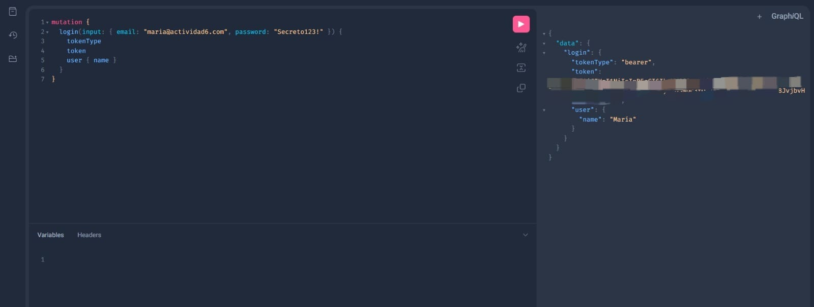

**Regla:** si el correo y la contraseña coinciden con el hash, el servidor firma y devuelve el token (`tokenType: bearer`). La respuesta no incluye el hash ni el secreto.

### Datos legibles del token
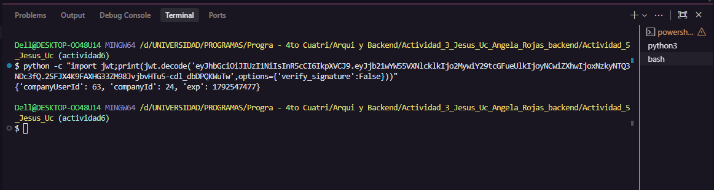

**Regla:** el token lleva solo `companyUserId`, `companyId` y `exp`. No lleva contraseña ni lista de permisos. Se muestra sin la firma completa.

### Login rechazado
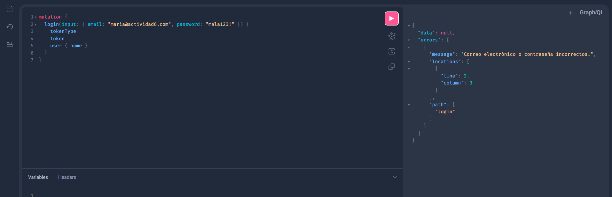

**Regla:** con correo o contraseña incorrectos no se entrega token.

## Los casos

### Caso 1 — Sin token, `createAccount`
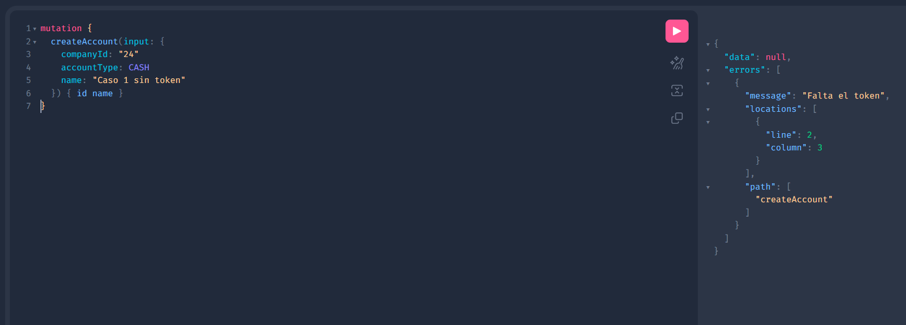

**Regla:** sin encabezado `Authorization` la operación responde `errors` y no guarda.

### Caso 2 — María (capturista), `createTransaction`
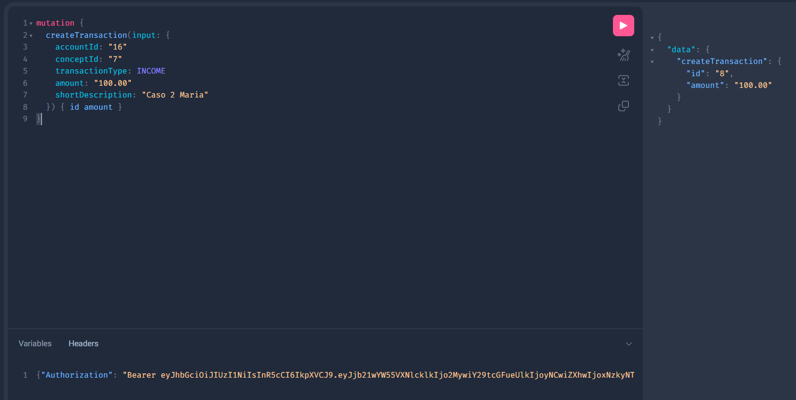

**Regla:** el rol capturista tiene `transactions.write`, así que el movimiento se guarda.

### Caso 3 — María (capturista), `createAccount`
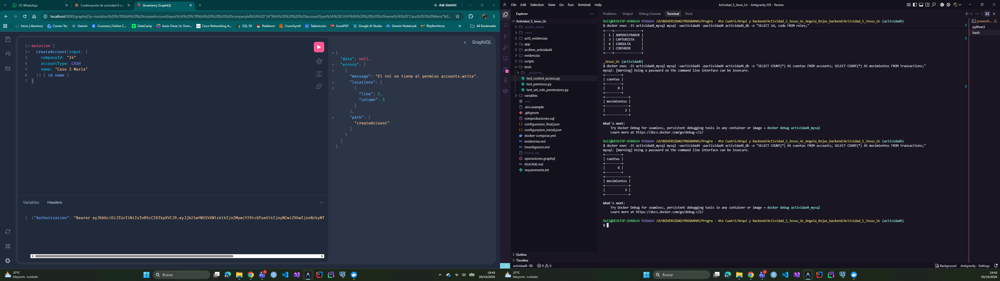

**Regla:** el rol capturista no tiene `accounts.write`. Un token válido no abre todas las rutas, solo las que el rol tiene concedidas.

### Caso 4 — Luis (contador), `createAccount`
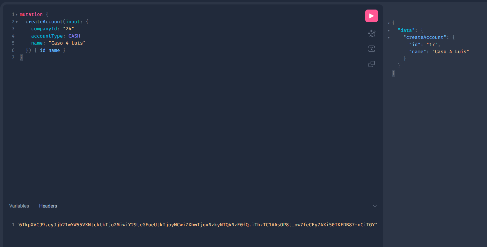

**Regla:** es la misma ruta que en el caso 3. El rol contador sí tiene `accounts.write`, así que el resultado depende del rol.

### Caso 5 — Pedro (consulta), `createTransaction`
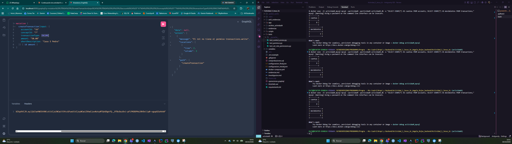

**Regla:** el rol consulta no tiene `transactions.write`, por lo que se rechaza y no se escribe.

### Caso 6 — Ana, `assignRole` (Pedro a CAPTURISTA)
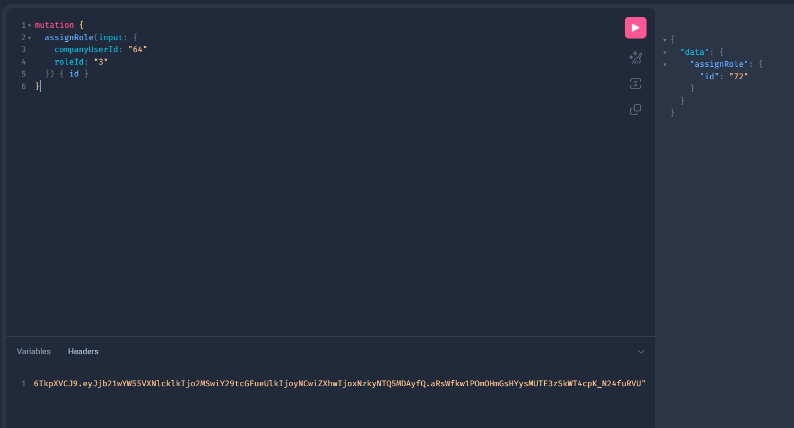

**Regla:** solo quien tiene `roles.write` (el administrador) puede asignar puestos.

### Caso 7 — Mismo token de Pedro, `createTransaction`
Sin captura en GraphiQL. Este caso está cubierto por la prueba automatizada de `tests/test_control_acceso.py` (`python -m pytest -v`, 38 pruebas pasando).

**Regla:** después de `assignRole`, la siguiente petición con el mismo token ya ve el rol nuevo, porque el rol se lee otra vez en MySQL y no viaja dentro del token.

### Caso 8 — Token de otra empresa, `accounts`
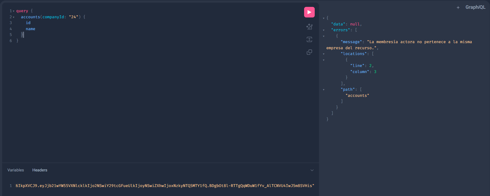

**Regla:** la empresa del token y la de la cuenta deben ser la misma. Un token de otra empresa no lee las cuentas de esta.

### Caso 9 — Token alterado y token vencido, `createAccount`
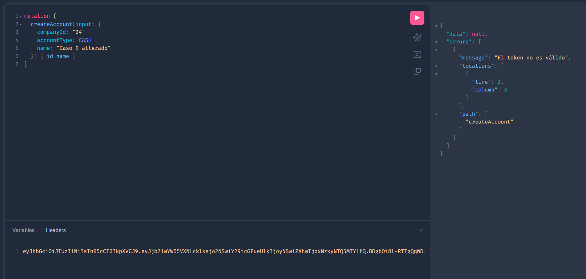

**Regla:** `jwt.decode` rechaza una firma alterada o un `exp` vencido. La operación responde `errors` y no se escribe.

## Seguridad del secreto

`JWT_SECRET` vive en el ambiente (`.env`, fuera de Git). El repositorio solo incluye `.env.example` con un valor de ejemplo. Al validar solo se acepta HS256.