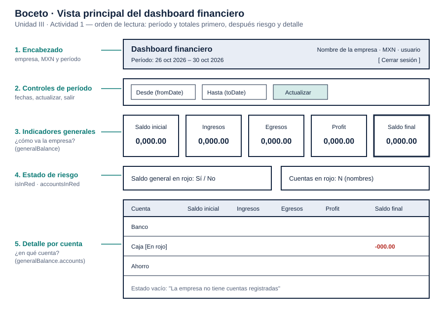
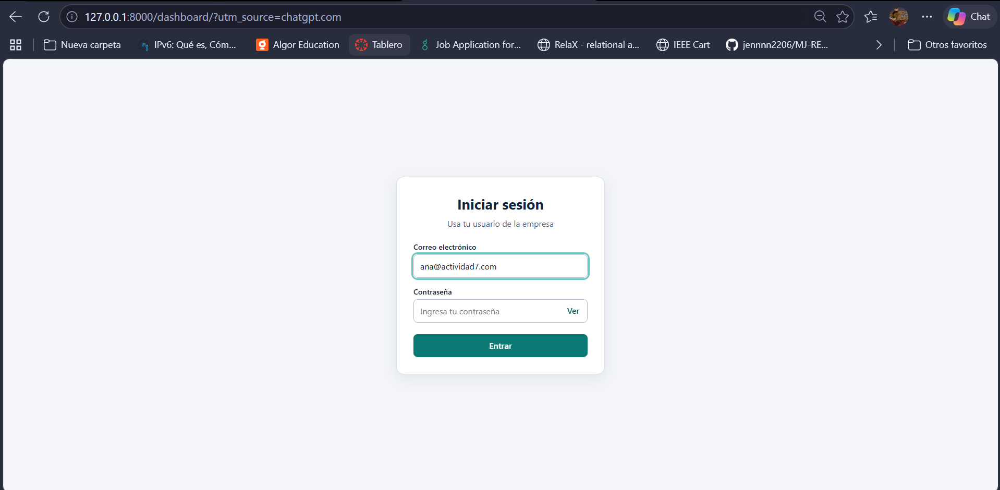
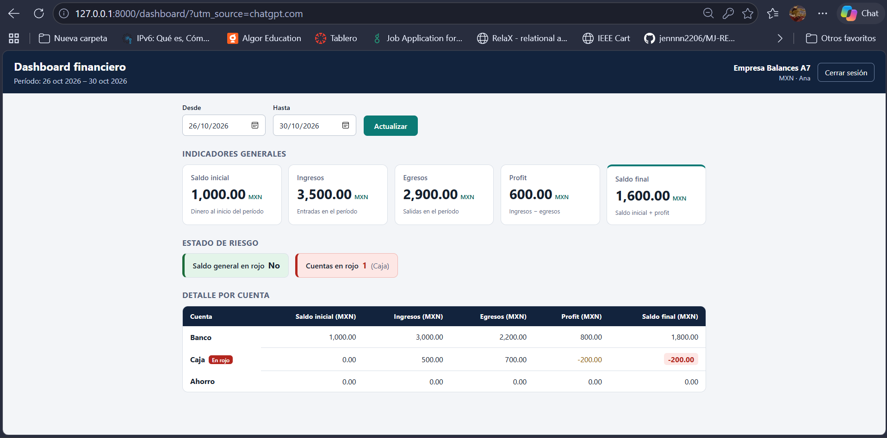
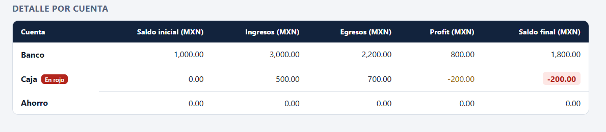
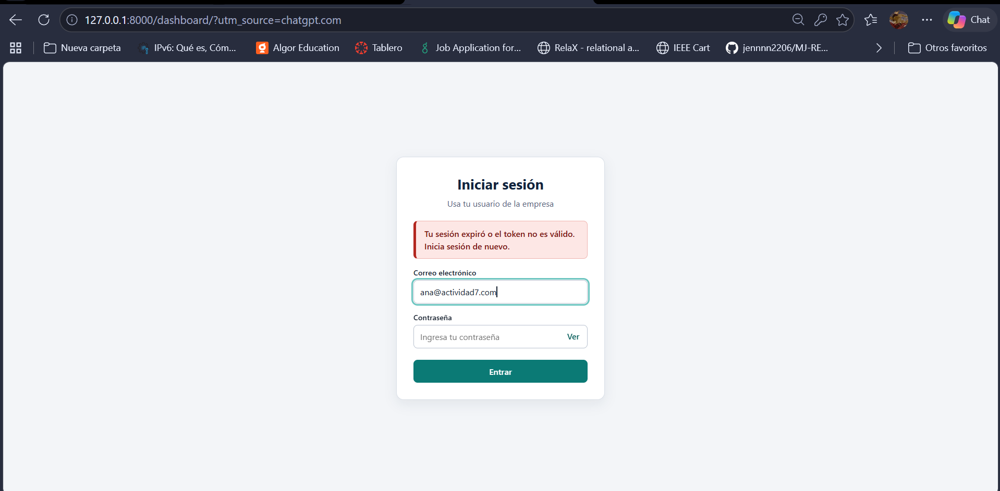
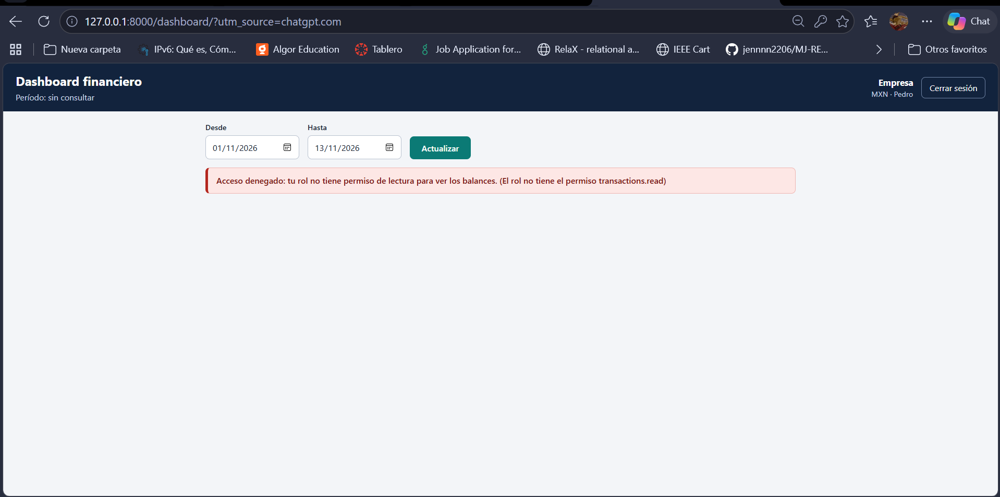
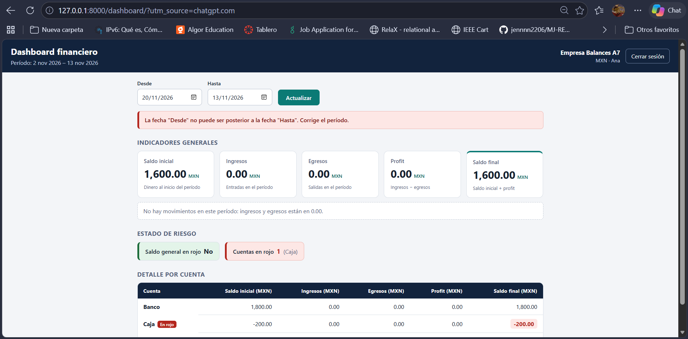
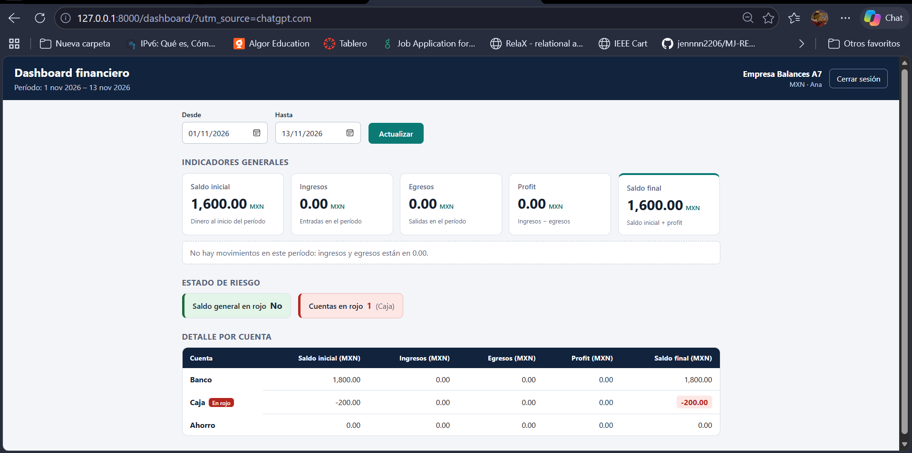

# Evidencias — Unidad III, Actividad 1 (Dashboard financiero)

Datos: `python scripts/preparar_demo_actividad7.py`. Usuario: `ana@actividad7.com`.
Período: 2026-10-26 a 2026-10-30. Las capturas van en `dashboard/evidencias/` con los nombres indicados.

## Boceto del diseño

## D01 — Login
Pantalla de inicio de sesión antes de entrar (usa la mutación `login`).

## D02 — Indicadores generales
Dashboard con el período 26–30 de octubre de 2026: saldo inicial 1,000.00, ingresos 3,500.00,
egresos 2,900.00, profit 600.00, saldo final 1,600.00, general en rojo: No, cuentas en rojo: 1 (Caja).

## D03 — Detalle por cuenta
Tabla con Banco, Caja (saldo final −200.00, en rojo) y Ahorro, del mismo resultado `generalBalance.accounts`.

## D04 — Caso de error: token inválido
Con la sesión abierta, en la consola del navegador (F12) ejecutar
`sessionStorage.setItem("sgi.token", "token.invalido.x")` y pulsar **Actualizar**. El dashboard vuelve
al login con el mensaje "Tu sesión expiró o el token no es válido. Inicia sesión de nuevo."

## D05 — Caso de error: usuario sin permiso
En GraphiQL, con el token de Ana, ejecutar `AplicarConfiguracion` con
`variables/a7_b14_quitar_transactions_read.json`. Eso le quita `transactions.read` al rol CONSULTA.
Entrar al dashboard con `pedro@actividad7.com` (CONSULTA): aparece "Acceso denegado…" y ningún número. Al terminar, restaurar con
`variables/a7_b14_restaurar_permisos.json`.

## D06 — Fechas inválidas
"Desde" posterior a "Hasta": el dashboard no llama al API y muestra el motivo.

## D07 — Cambio de período
Mismo usuario con 2026-11-01 a 2026-11-13: el encabezado cambia de período, saldo inicial 1,600.00 y
el aviso de que no hay movimientos.

