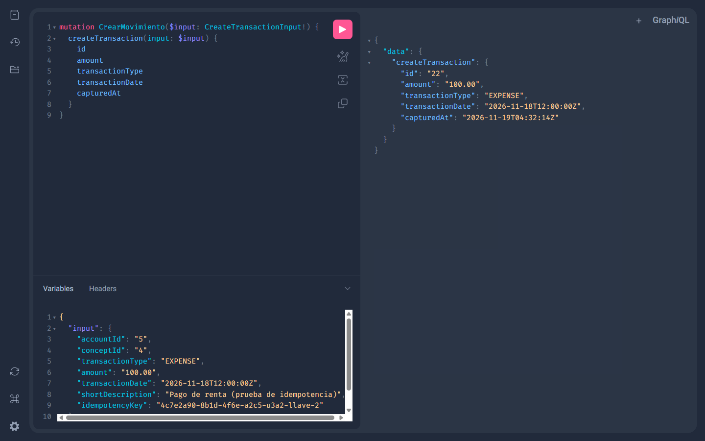
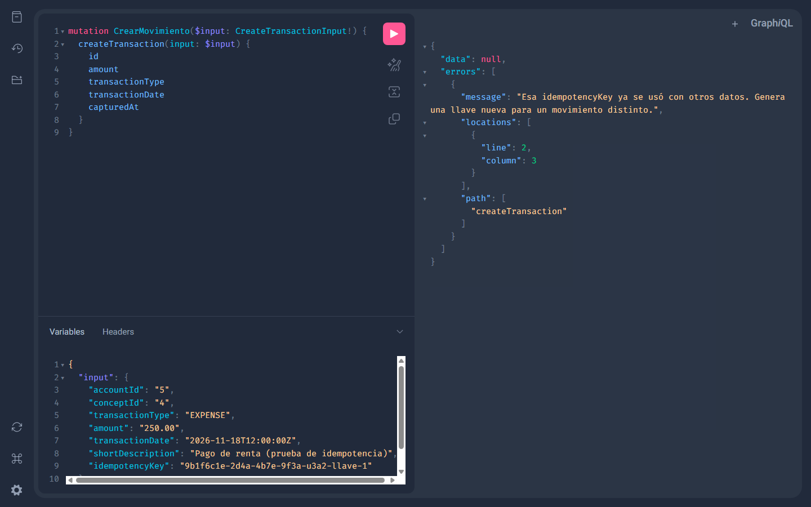
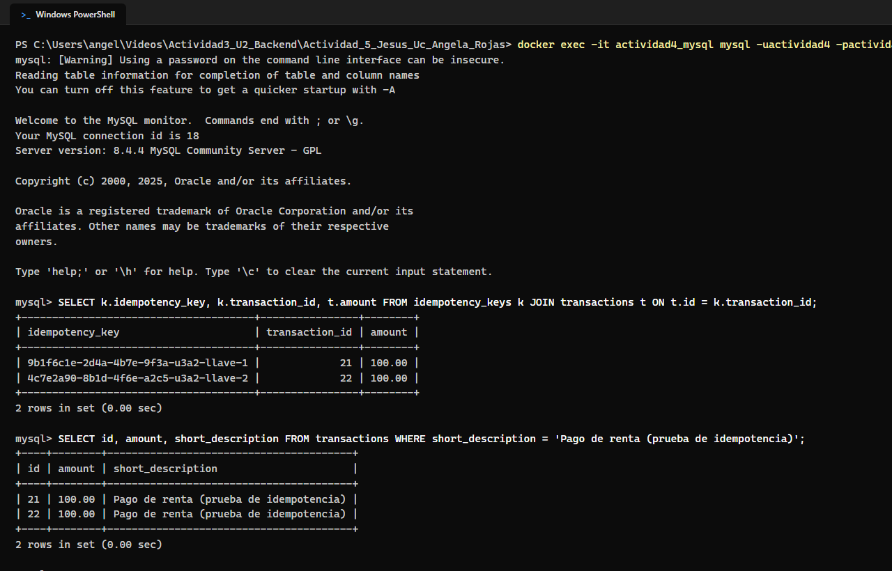
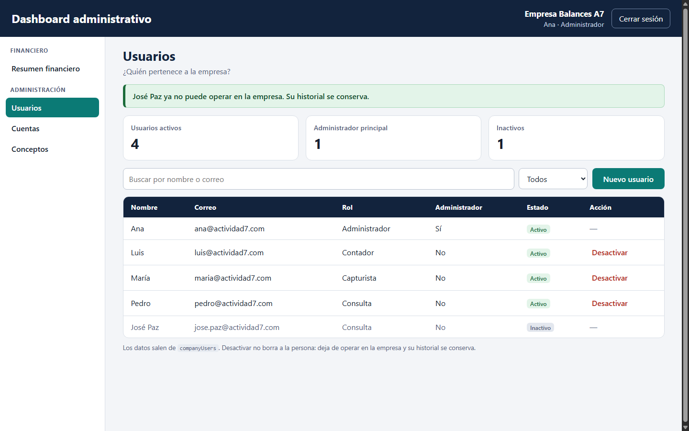
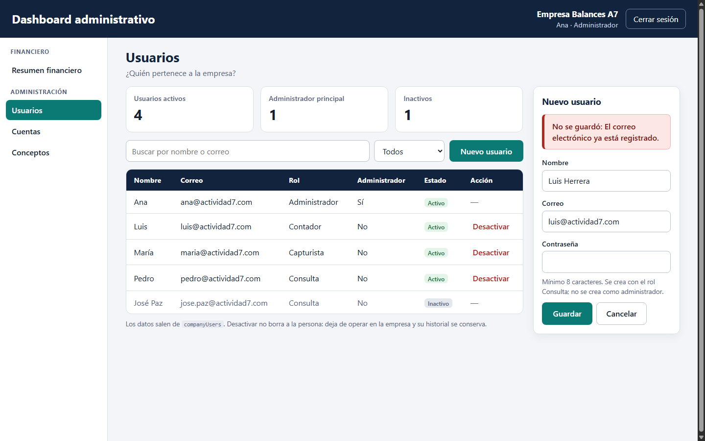
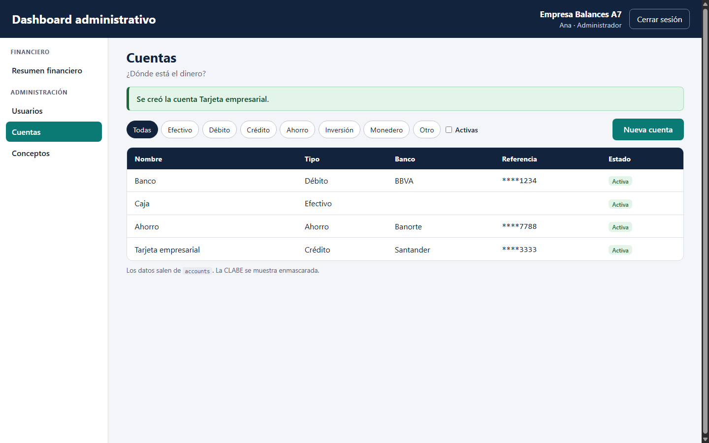
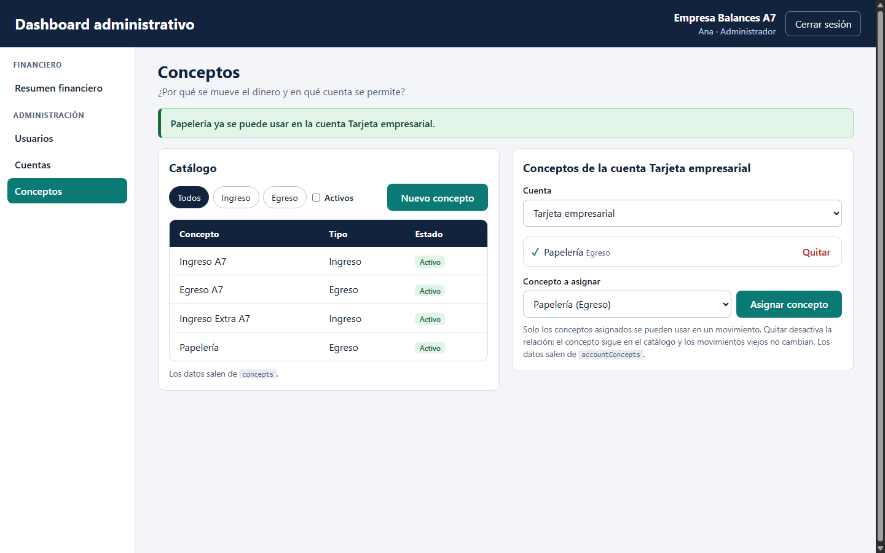
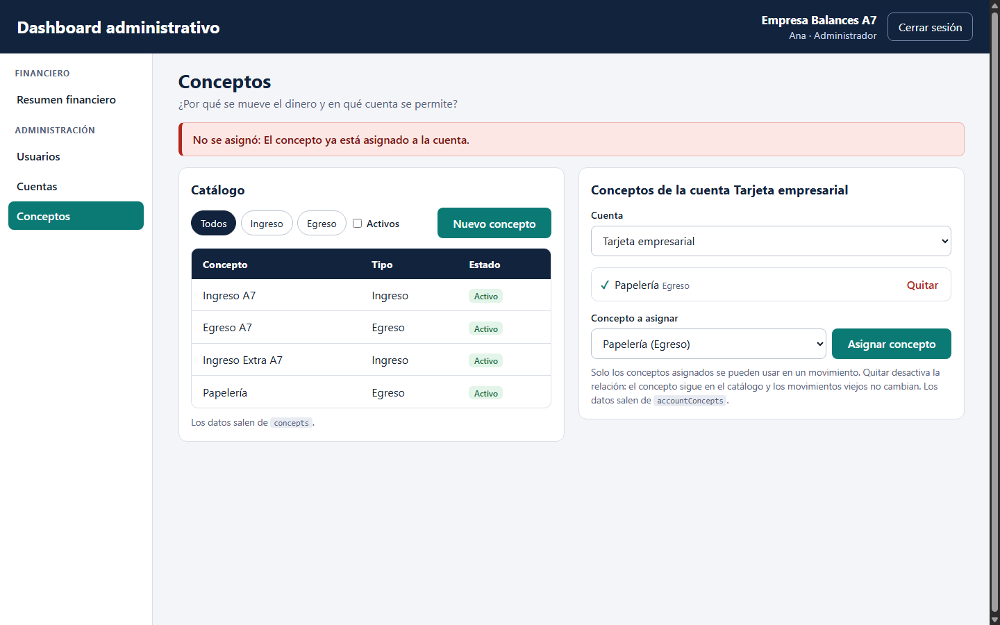
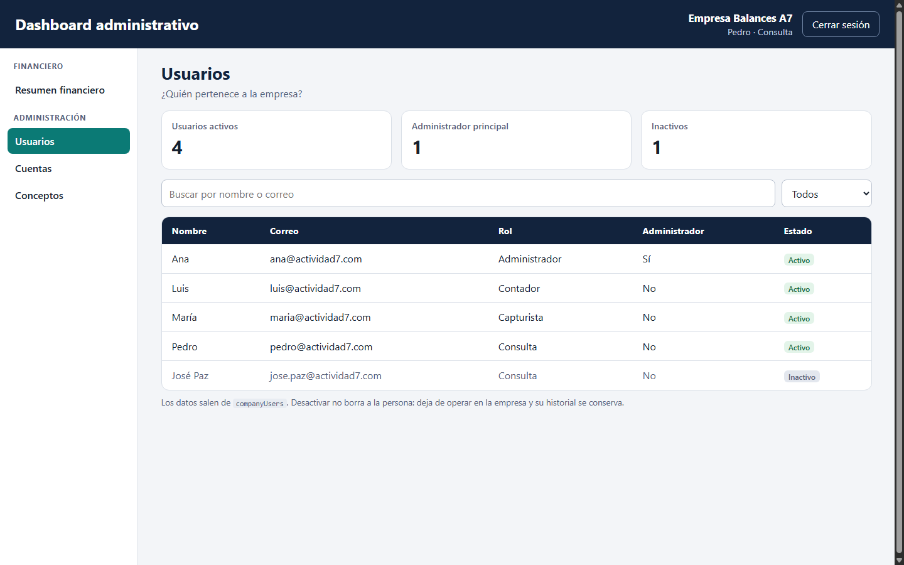

# Evidencias — Unidad III, Actividad 2 (Idempotencia y dashboard administrativo)

Datos: `python scripts/preparar_demo_u3a2.py` (desde `Actividad_5_Jesus_Uc/`). Empresa: Empresa Balances A7.
Escritura probada con `ana@actividad7.com` (rol ADMINISTRADOR); solo lectura con `pedro@actividad7.com`
(rol CONSULTA). Las capturas están en `dashboard/evidencias/`.

## Parte 1. Idempotencia en `createTransaction`

Mutación `CrearMovimiento` de `Actividad_5_Jesus_Uc/operaciones.graphql`, con el token de Ana en el
header `Authorization: Bearer …`.

### A2_E01 — Primer envío con la llave 1
Variables `variables/u3a2_tx_llave1.json`. Se crea el movimiento y la llave en el mismo `COMMIT`.

### A2_E02 — Reintento con la misma llave: el mismo id
Mismas variables, segundo envío. La respuesta es la misma que la primera (mismo `id`): no hubo otro `INSERT`.

### A2_E03 — Otra llave: otro movimiento
Variables `variables/u3a2_tx_llave2.json`: mismo monto, llave distinta. Es un segundo movimiento legítimo (otro `id`).

### A2_E04 — La misma llave con otro monto se rechaza
Variables `variables/u3a2_tx_llave1_otro_monto.json`: "Esa idempotencyKey ya se usó con otros datos."

### A2_E05 — MySQL: una fila por llave
Consultas 1 y 3 de `Actividad_5_Jesus_Uc/comprobaciones_u3a2.sql`: dos llaves, dos movimientos.

## Parte 2. Dashboard administrativo

### A2_E06 — Usuarios
Tabla de `companyUsers` con nombre, correo, rol, administrador y estado. Incluye el usuario dado de alta
desde el dashboard y desactivado (fila inactiva, no borrada).

### A2_E07 — Error: correo duplicado
Alta con un correo que ya existe: el error del API se lee en el formulario.

### A2_E08 — Cuentas
Tabla de `accounts` con tipo en español, banco y CLABE enmascarada, incluida la cuenta creada desde el dashboard.

### A2_E09 — Conceptos
Catálogo de `concepts` y, a la derecha, los conceptos asignados a la cuenta elegida (`accountConcepts`).

### A2_E10 — Error: concepto ya asignado
Asignar otra vez el mismo concepto a la misma cuenta: "El concepto ya está asignado a la cuenta."

### A2_E11 — Usuario de solo consulta
Pedro (CONSULTA) ve las tablas, pero no los botones de alta, Desactivar, Asignar ni Quitar.

