# Evidencias — Unidad III, Actividad 3 (Matriz de roles y permisos)

Datos: `python scripts/preparar_demo_u3a3.py` (desde `Actividad_5_Jesus_Uc/`). Empresa: Empresa Balances A7.
La matriz se edita con `ana@actividad7.com` (ADMINISTRADOR) y el efecto se comprueba con
`maria@actividad7.com` y `jose@actividad7.com` (CAPTURISTA) y `pedro@actividad7.com` (CONSULTA).
Las capturas están en `dashboard/evidencias/`.

### A3_E01 — La matriz inicial
Sesión de Ana: los diez permisos en cinco grupos y las cuatro columnas coinciden con la tabla de la sección 2.2; Administrador es de solo lectura.

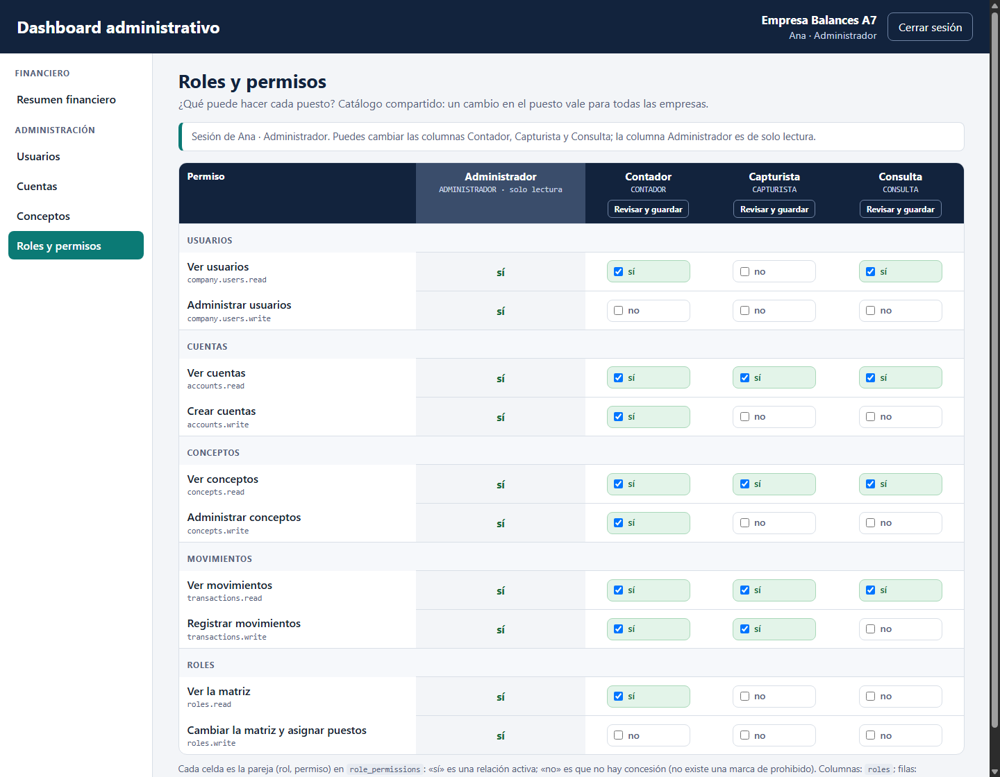

### A3_E02 — La columna Capturista en GraphiQL
`rolePermissions` del rol CAPTURISTA devuelve las mismas cuatro relaciones activas que la columna de la pantalla.

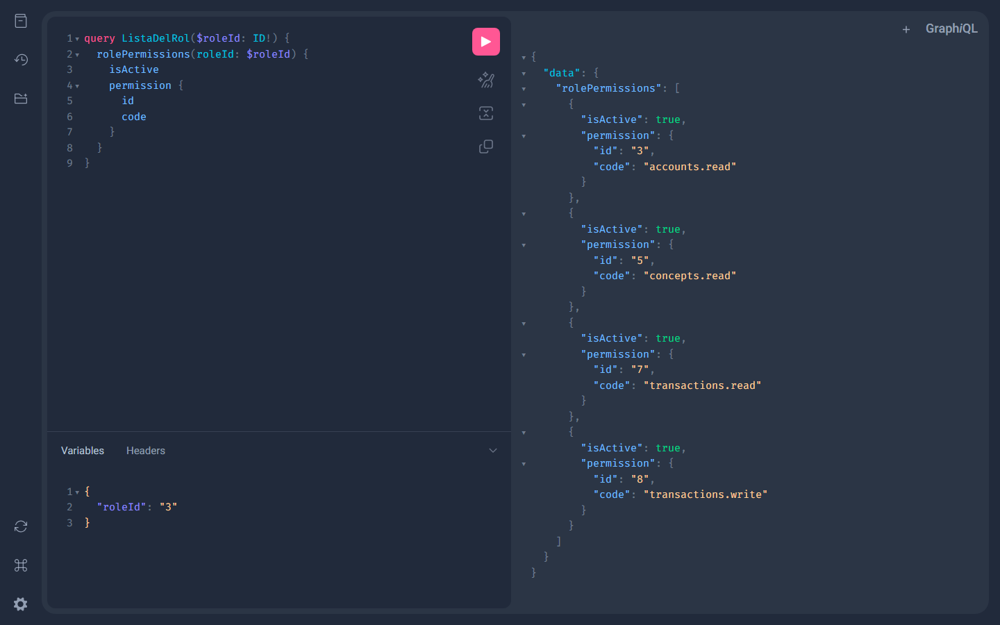

### A3_E03 — Vista previa: activar accounts.write
Al marcar Crear cuentas en Capturista, `previewRolePermissions` anuncia: se activa `accounts.write`, no se desactiva nada, 4 sin cambio, total final 5.

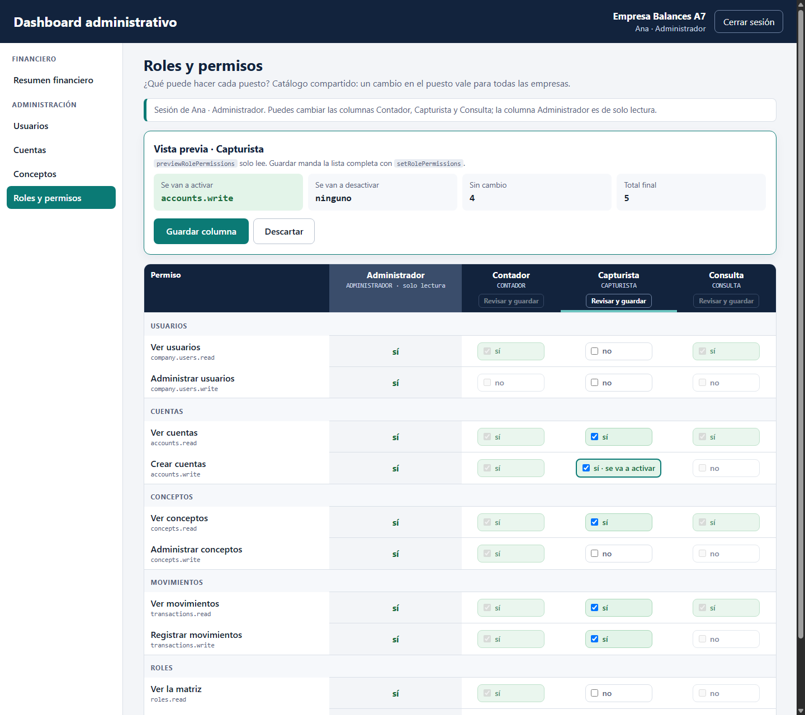

### A3_E04 — Cuentas de la capturista antes y después del guardado
Antes, María ve la tabla de Cuentas sin el botón Nueva cuenta; después de guardar la columna, el botón aparece sin que se editara su fila en Usuarios.

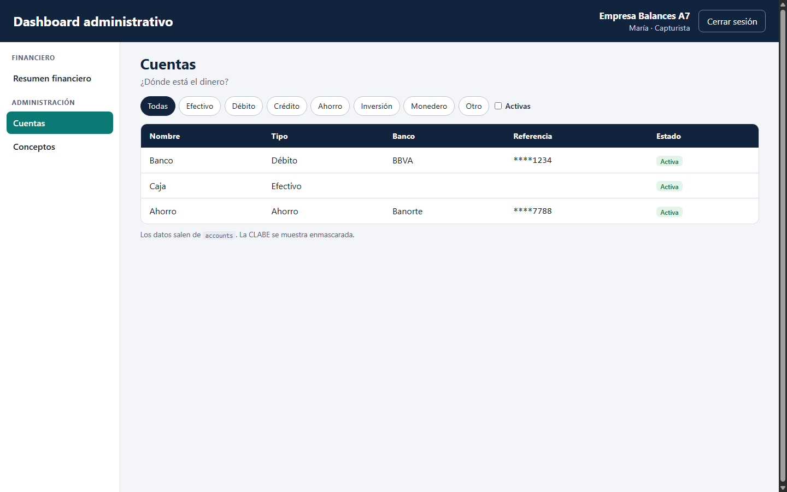

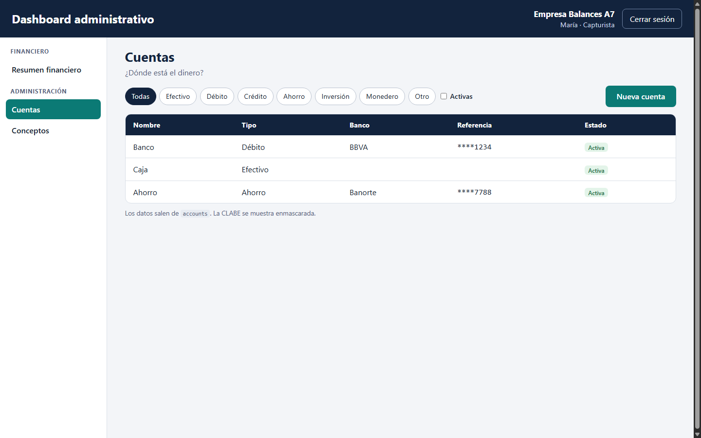

José, el segundo capturista, también ve Nueva cuenta: la celda es del puesto, no de la persona.

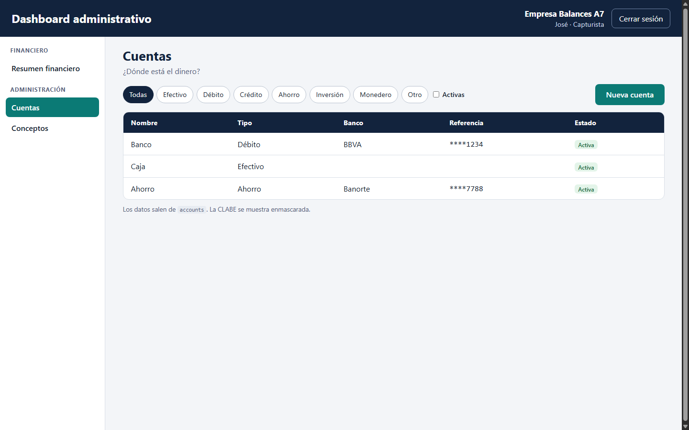

### A3_E05 — Cambio de puesto de Consulta a Capturista
En Usuarios, Pedro pasa de Consulta a Capturista con `assignRole`; isAdmin sigue en No.

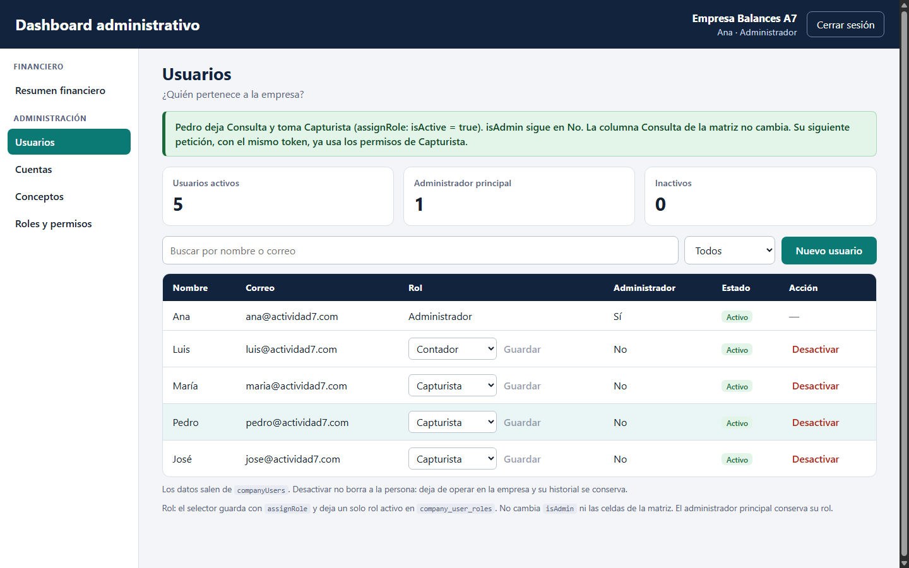

La columna Consulta de la matriz sigue igual después del cambio de puesto.

### A3_E06 — Segundo guardado de la misma columna
Guardar otra vez la columna Capturista sin cambios responde `changed = false` y no duplica filas.

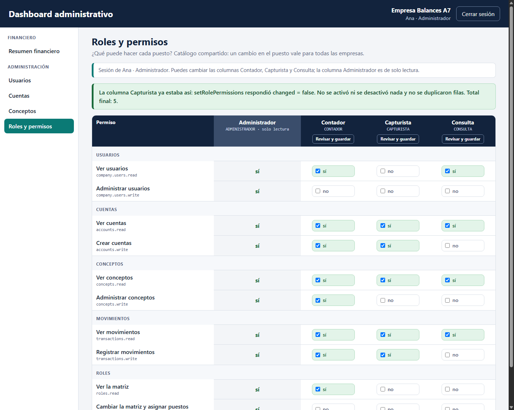

### A3_E07 — Sin roles.write no se guarda; sin roles.read no se ve
El contador ve la matriz deshabilitada y sin botones de guardar.

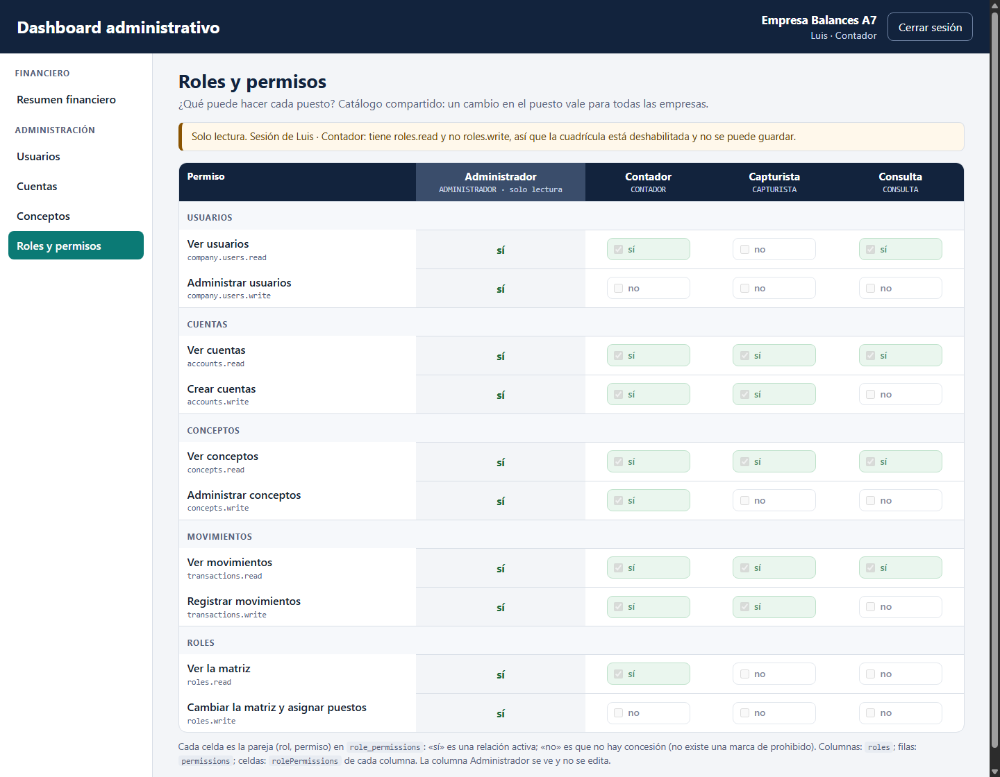

La capturista no tiene el ítem Roles y permisos en el menú.

### A3_E08 — El mismo token ya puede registrar un movimiento
Pedro, con la sesión que abrió siendo Consulta, ve Registrar movimiento en su siguiente petición y registra un ingreso: el servidor volvió a leer `company_user_roles`.

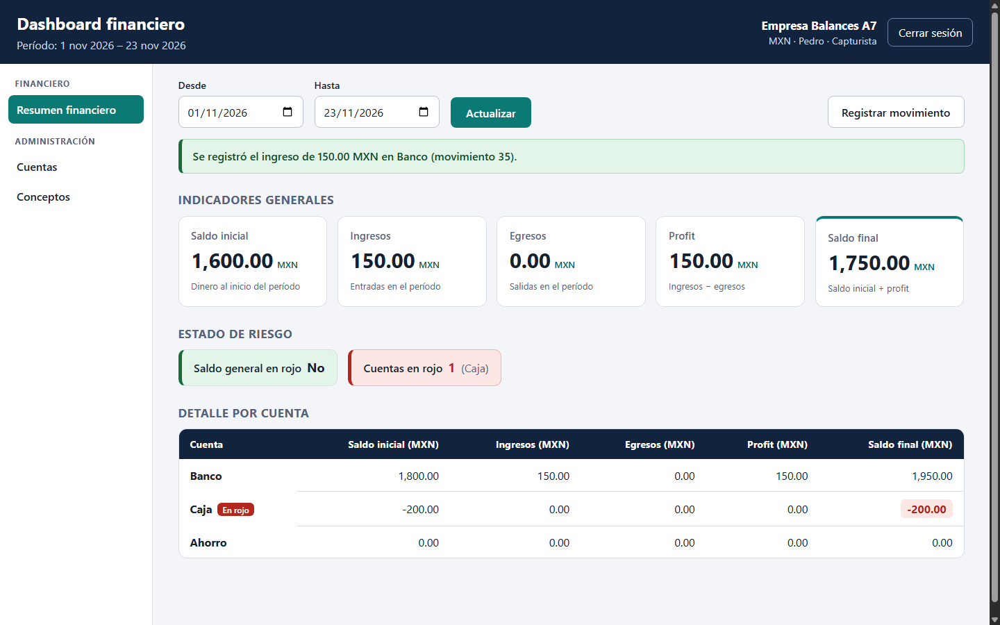

### A3_E09 — MySQL
La columna Capturista con `accounts.write` activa, cero parejas repetidas y un solo rol activo por persona (`comprobaciones_u3a3.sql`).

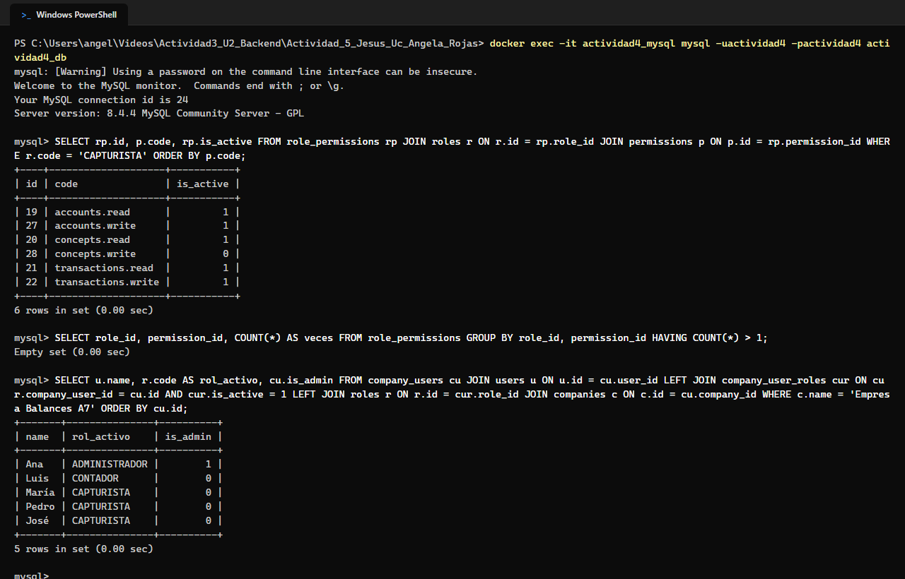
